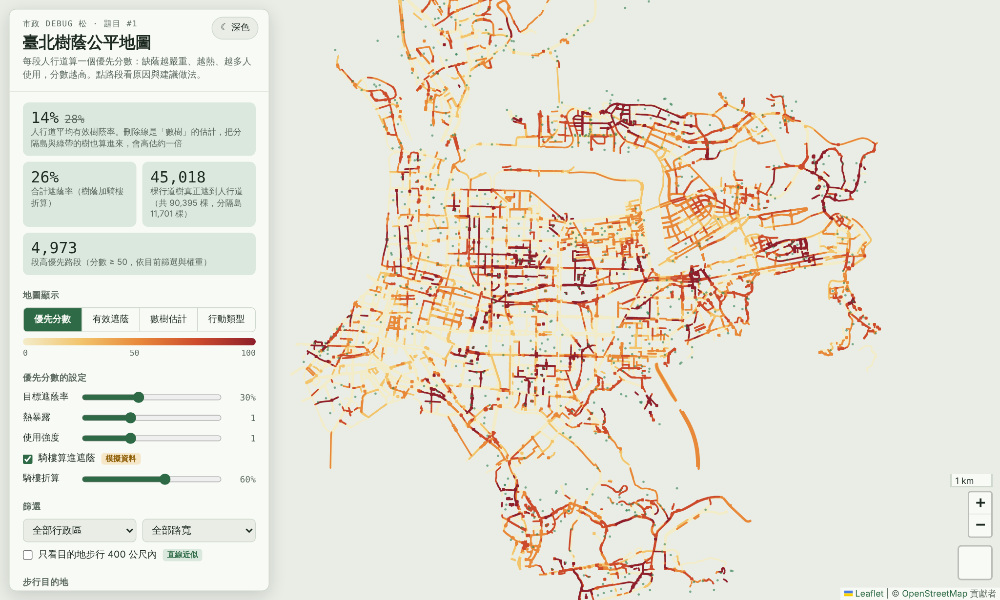
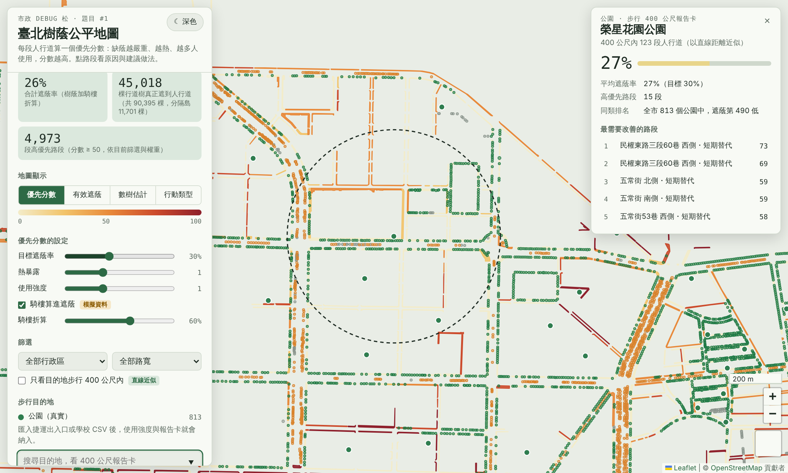
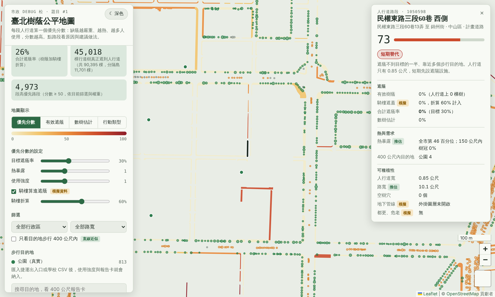
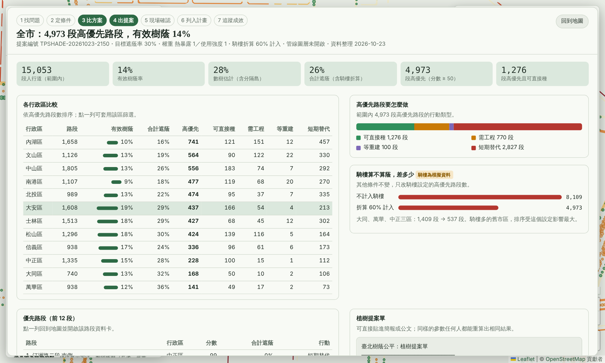
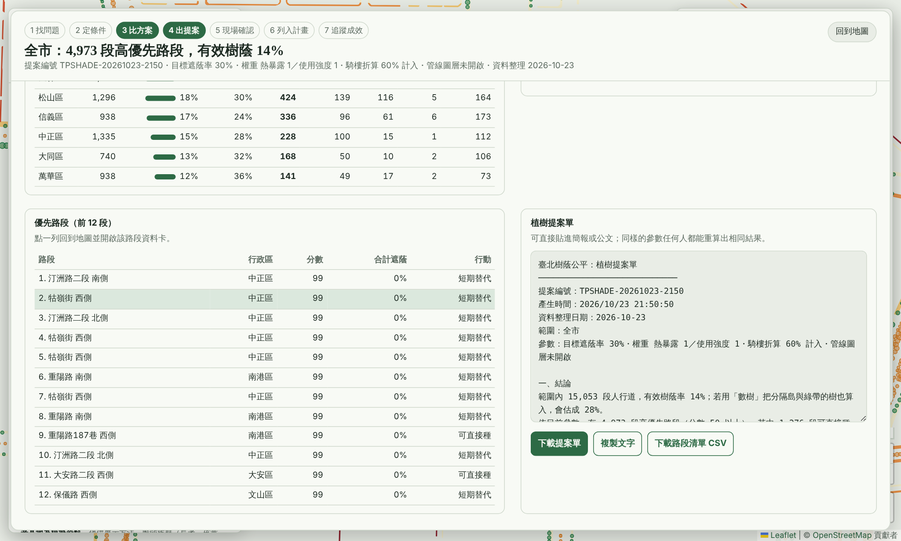

# 臺北樹蔭公平地圖

市政 debug 松 題目 #1「把三千棵樹種回來」：找出城市空間把樹種回來，達到樹蔭公平。

把每段人行道當成一張成績單：**缺蔭越嚴重、越熱、越多人需要，優先分數越高**。再依人行道寬度、空樹穴、管線、都更危老，判斷該段路要「直接種」「做工程」「等重建」還是「先用遮陽設施」。

## 怎麼開啟

- **線上**：開啟本專案的 GitHub Pages 網址（啟用方式見文末「發布到 GitHub Pages」）。
- **本機**：下載 `index.html`，直接用瀏覽器開啟（需連網載入 OpenStreetMap 底圖與套件）。
- `index.html` 約 6 MB，資料已嵌入，不需要後端。



## 一句話發現

全市人行道平均**有效樹蔭率只有 14%**；如果用「數樹」把分隔島與綠帶的樹也算進來，會估成 28%，高估約一倍。90,395 棵行道樹中，只有 45,018 棵真正落在人行道上，另有 11,701 棵在分隔島。

## 畫面

| 400 公尺報告卡 | 路段資料卡 |
| --- | --- |
|  |  |

| 儀表板 | 植樹提案單 |
| --- | --- |
|  |  |

## Demo 流程（約 2 分鐘）

1. 開場看左上角：有效樹蔭 14%、數樹估計 28%。切換「有效遮蔭」與「數樹估計」，看分隔島樹扣掉後的差別。
2. 拖入捷運出入口 CSV，在「搜尋目的地」選一個站，看步行 400 公尺報告卡。
3. 點報告卡裡分數最高的路段，看資料卡：為什麼高分、屬於哪種行動類型。
4. 取消「騎樓算進遮蔭」：高優先路段從 4,973 段增加到 8,109 段，大同、萬華、中正從 537 段增加到 1,409 段。騎樓算不算蔭，是需要公開討論的政策選擇。
5. 拉動「熱暴露」或「使用強度」權重，看排名變化。
6. 按「開啟儀表板與植樹提案單」，點一個行政區，下載提案單。

## 決策流程

平台把「看圖」變成七個有紀錄的步驟，前四步在畫面上完成，後三步交給局處：

1. **找問題**：優先分數地圖，或從捷運站、學校的 400 公尺報告卡切入。
2. **定條件**：目標遮蔭率、熱暴露與使用強度的權重、騎樓算不算蔭。每次調整都寫進提案單的「參數調整紀錄」。
3. **比方案**：「儀表板」比較各行政區、行動類型，並顯示騎樓設定改變時高優先路段差多少。點行政區可直接套用篩選。
4. **出提案**：儀表板下方的「植樹提案單」有提案編號、範圍、參數、前 20 段建議路段、各區統計與資料說明，可下載文字檔或複製；同樣的參數任何人都能重算出相同結果。
5. **現場確認**：公園處、新工處會勘管線、寬度與空樹穴，回填可種、不可種與原因。
6. **列入計畫**：可種的路段列入年度植樹計畫；「等重建」路段轉都市更新處，在審議時要求退縮植樹。
7. **追蹤成效**：每年依相同參數重算，看高優先路段是否減少。移樹前也先看該段遮蔭會掉多少。

第 5 到 7 步的正式版建議用 Google 試算表當後台，記錄每段路的狀態（候選、已會勘、已列入計畫、已種植、已追蹤），GAS 版可直接讀寫。

## 方法

```
優先分數 = 100 ×（缺蔭程度）×（需要程度）
缺蔭程度 = max(0, (目標遮蔭率 − 合計遮蔭率) ÷ 目標遮蔭率)
合計遮蔭率 = 有效樹蔭率 + 騎樓折算係數 × 騎樓遮蓋率 ×（1 − 有效樹蔭率）
需要程度 = 熱暴露與使用強度的加權平均（權重可在畫面上調整）
```

- **有效樹蔭率**：樹冠圓與人行道面的重疊面積 ÷ 人行道面積。分隔島上的樹除非樹冠伸進人行道，否則不計入。
- **樹冠半徑**：0.8 + 0.055 × 胸徑（公分），限制在 1 到 8 公尺。這是簡化的推估公式，正式版應依樹種校正，或改用航照、光達樹冠資料。
- **使用強度**：步行目的地 400 公尺內的路段加權（捷運、學校 1、公車 0.6、公園 0.4）。MVP 用直線距離近似。
- **行動類型**：已達目標→已達標；有空樹穴或人行道寬 3 公尺以上且無管線衝突→可直接種；旁邊有都更危老案→等重建；人行道寬 2 公尺以上或有管線衝突→需工程；其餘→短期替代。

## 哪些是真實資料、哪些是模擬

| 圖層 | 狀態 | 來源或做法 |
| --- | --- | --- |
| 行道樹（90,395 棵） | 真實 | 臺北市行道樹及公園樹木分布圖 |
| 人行道範圍（15,053 段） | 真實 | 臺北市人行道範圍圖 |
| 樹穴（去除重複後 1,309 處） | 真實 | 臺北市人行道固定設施物＿樹穴 |
| 公園（813 座） | 真實 | 臺北市公園基本資料 |
| 捷運出入口、學校、公車站 | 真實（需匯入） | 由使用者匯入 data.taipei 的 CSV |
| 分隔島樹分類 | 真實推算 | 位置說明文字 + 與人行道的距離（1.5 公尺內算人行道） |
| 空樹穴 | 真實推算 | 樹穴 2 公尺內沒有行道樹（545 處） |
| 路寬 | 推估 | 同路名對側人行道之間的距離加上兩側人行道寬 |
| 樹冠範圍 | 推估 | 胸徑換算樹冠半徑 |
| 熱暴露 | 推估 | 周邊 150 公尺樹冠比例與離 1 公頃以上公園的距離，非實測地表溫度 |
| 騎樓 | **模擬** | 依行政區與路段特性產生，同一條路同一側共用 |
| 地下管線衝突 | **模擬** | 展示外掛圖層功能 |
| 都更、危老基地（160 處） | **模擬** | 展示「等重建」行動類型 |

模擬資料都用固定種子產生，每次重算結果相同；畫面上以「模擬」標籤標示。

## 如果市府上任 100 天內要落地

目標：第 100 天選出 3 個捷運站與 3 所國小周邊試辦，產出第一批可種植清單。成本以三級標示，實際金額需各局處報價。

| 局處 | 要做什麼 | 需要的資料 | 成本 |
| --- | --- | --- | --- |
| 工務局公園路燈工程管理處 | 行道樹資料補「人行道／分隔島」欄位與空樹穴；開放移樹紀錄與原因 | 樹籍、移樹履歷 | 低：既有人力 |
| 工務局新建工程處 | 提供騎樓範圍；與管線單位建立管線外掛圖層的存取權限 | 騎樓整平路段、管線圖資 | 中：可能需委外整理 |
| 都市發展局、都市更新處 | 提供都更危老案位置與階段；研擬退縮植樹加碼獎勵；提供都市計畫道路寬度 | 案件清冊、道路寬度 | 低到中 |
| 社會局、民政局 | 與公衛單位釐清脆弱族群與熱危害的關聯，確認是否及如何納入分數 | 各里年齡人口、去識別的社福統計 | 低 |
| 交通局 | 評估高分路段的路邊停車格轉植樹帶試辦 | 路邊停車格圖層 | 中 |
| 資訊局 | 平台開源上線，每年重算一次 | 以上全部 | 低：沿用開源工具 |

## 限制

- 脆弱族群（長者、孩童、低收）暫不納入分數：它與熱危害、步行行為的關聯還需要釐清，正式版確認指標與資料來源（例如各里年齡人口、社會局統計）後再加入。
- 樹冠以胸徑推估，未含私有地、校園內的樹；可改接中研院「台北樹冠觀測」（Sentinel-2，10 公尺）看行政區趨勢，或用航照、光達做路段層級。
- 熱暴露不是實測值；正式版應改用 Landsat 夏季地表溫度。
- 400 公尺以直線近似，正式版改用步行路網。
- 修剪對遮蔭的影響尚未納入。

## 使用的開源套件、資料與 AI 工具

- 網頁：Leaflet 1.9.4、PapaParse 5.4.1、proj4js 2.9.0、OpenStreetMap 圖磚（© OpenStreetMap 貢獻者）
- 前處理：Python（pandas、numpy、shapely、pyproj）
- AI 工具：Claude（Anthropic），用於資料處理程式、網頁與文件撰寫

## 檔案結構

```
index.html               MVP 網頁（資料已嵌入，GitHub Pages 直接使用）
src/app_src.html         網頁原始碼（資料位置為 __DATA__）
src/prep_mvp.py          前處理：從開放資料計算每段人行道的指標
src/build.py             把計算結果嵌入網頁，產生 index.html
data/                    臺北市開放資料原始檔（見 data/README.md）
gas/                     Google Apps Script 版（Code.gs、Index.html、shade_data.txt）
docs/screenshots/        畫面截圖
```

## 從開放資料重新產生

```
pip install pandas numpy shapely pyproj
cd src
python prep_mvp.py    # 產生 src/mvp_data.json
python build.py       # 產生根目錄的 index.html
```

模擬資料以固定種子產生，重算結果與本專案的 `index.html` 相同。

## Google Apps Script 版

`gas/` 是部署在 GAS 的版本：網頁 `Index.html` 與壓縮資料 `shade_data.txt` 放在 Google 雲端硬碟資料夾，`Code.gs` 負責讀取。使用時把 `Code.gs` 的 `FOLDER_ID` 換成自己的資料夾 ID，部署為網頁應用程式（執行身分：我；存取權：所有人）。

## 發布到 GitHub Pages

到專案的 Settings → Pages，Source 選「Deploy from a branch」，Branch 選 `main`、資料夾 `/ (root)`，儲存後約一分鐘，網址會顯示在同一頁。

## 授權

開放資料依[政府資料開放授權條款－第 1 版](https://data.gov.tw/license)使用；底圖 © OpenStreetMap 貢獻者。作品授權由團隊決定，主辦單位建議 MIT 或 CC BY 4.0。
